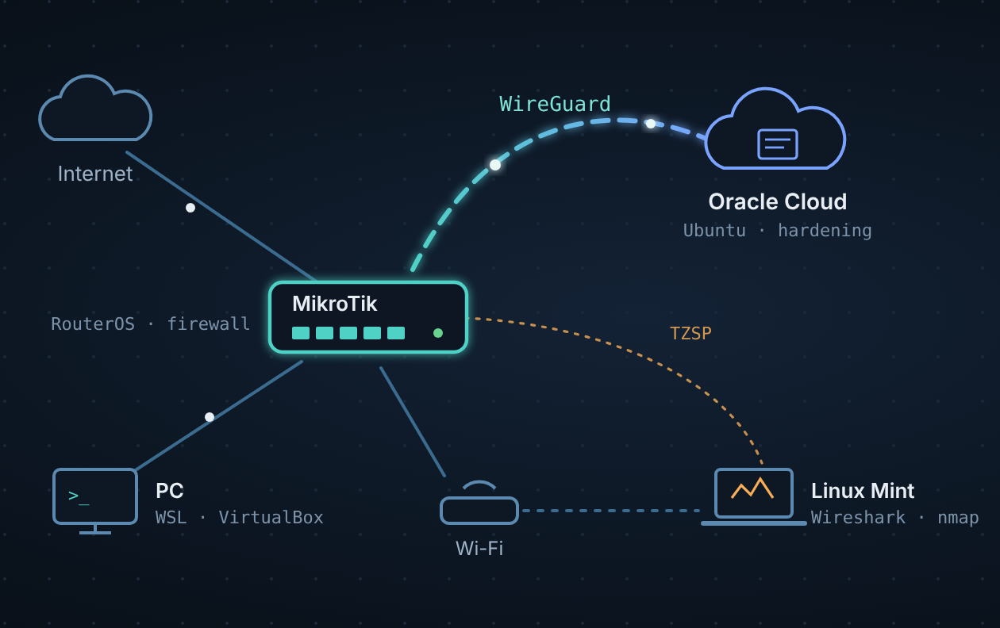

# 01 · Topologia

## Visão geral

A MikroTik é o centro da rede. Cada porta tem uma função definida e as redes são separadas por finalidade. Assim, um dispositivo de IoT (Alexa, câmeras) não fica na mesma rede da porta de administração.

> Os endereços abaixo são **exemplos** para documentação. Os reais não são publicados.

| Segmento | Interface (exemplo) | Rede (exemplo) | Finalidade |
|---|---|---|---|
| WAN | `ether1` | IP do provedor (atrás de CGNAT) | Saída para a internet |
| Wi-Fi | `ether2` → VLAN | `192.168.20.0/24` | Roteador Wi-Fi: celulares, notebook, IoT |
| LAN | `ether3` + `ether4` (bridge) | `192.168.10.0/24` | Dispositivos cabeados da casa |
| Gerência | `ether5` | `192.168.99.0/24` | **Única porta física** com acesso administrativo à MikroTik |
| VPN | `wg-cloud` | `10.200.0.0/24` | Túnel WireGuard até a nuvem |

## Decisões de projeto

**Porta de gerência dedicada.** A administração da MikroTik (WinBox, SSH, MAC-WinBox, descoberta de vizinhos) só responde pela porta de gerência e pelo túnel VPN. Quem está no Wi-Fi ou na LAN comum não chega na tela de login.

**Interface lists.** Em vez de repetir nomes de portas nas regras, as interfaces são agrupadas em listas (`WAN`, `LAN`, `MGMT`). As regras de firewall e os serviços apontam para as listas, o que deixa a configuração mais legível e fácil de mudar.

**Leases DHCP estáticos.** Dispositivos fixos (DVR, impressora, IoT) recebem sempre o mesmo IP. Isso facilita regras de firewall por endereço e o inventário da rede.

**VPN como segunda via de gerência.** Mesmo fora de casa, consigo administrar a rede pelo túnel, sem abrir nenhuma porta da MikroTik para a internet.

## Estações

| Máquina | Uso |
|---|---|
| PC Windows 11 | Administração via WinBox; WSL 2 com Kali, Ubuntu e AlmaLinux para praticar Debian × Red Hat; VirtualBox para labs em rede isolada |
| Notebook Linux Mint | Estação de análise: recebe a captura remota da MikroTik (TZSP) e roda Wireshark, tcpdump e nmap. Configuração reaplicável por script de setup |
